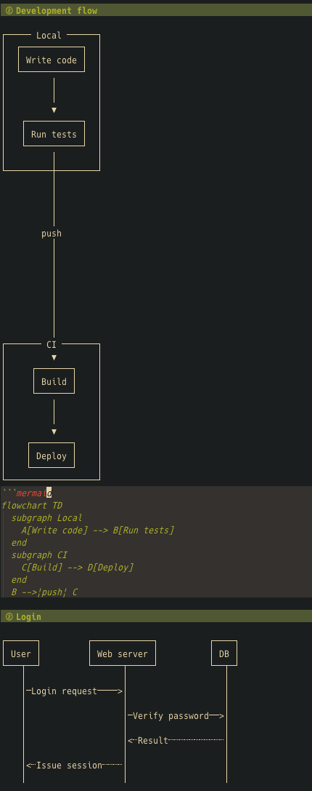

# mermaid-inline.nvim

Render Mermaid code blocks in Markdown buffers as Unicode box-drawing text, right inside Neovim.

Rendering is delegated to [mmdflux](https://crates.io/crates/mmdflux), which handles East Asian wide characters correctly.



## Features

- Renders every ` ```mermaid ` block as virtual lines in place of the block
- Hides the source while the cursor is outside the block (like render-markdown.nvim), shows it when the cursor enters
- Diagrams wider than the window are truncated with a hint; `:MermaidInlineOpen` shows the whole diagram in a floating window
- Parse errors are reported via `vim.diagnostic` on the offending line
- Rendering runs asynchronously and results are cached per source

## Requirements

- Neovim >= 0.11 (`conceal_lines`)
- Markdown treesitter parser
- [mmdflux](https://crates.io/crates/mmdflux) in `PATH` (`cargo install mmdflux`)
- `conceallevel` >= 1 for hiding the source (render-markdown.nvim sets this for you)

## Installation

### [lazy.nvim](https://github.com/folke/lazy.nvim)

```lua
{
  "ambit418/mermaid-inline.nvim",
  ft = { "markdown" },
  opts = {},
  keys = {
    { "<leader>mo", "<cmd>MermaidInlineOpen<cr>", ft = "markdown", desc = "Mermaid diagram (full width)" },
  },
}
```

## Configuration

```lua
{
  cmd = { "mmdflux" }, -- renderer; receives Mermaid source on stdin
  timeout_ms = 5000,
  conceal = true,      -- hide the source block when the cursor is outside it
}
```

## Commands

- `:MermaidInlineRender` — re-render the current buffer
- `:MermaidInlineOpen` — open the diagram under the cursor in a floating window (`q` to close)

## Highlights

- `MermaidInline` — diagram text (default: `Normal`)
- `MermaidInlineHint` — truncation hint (default: `Comment`)
